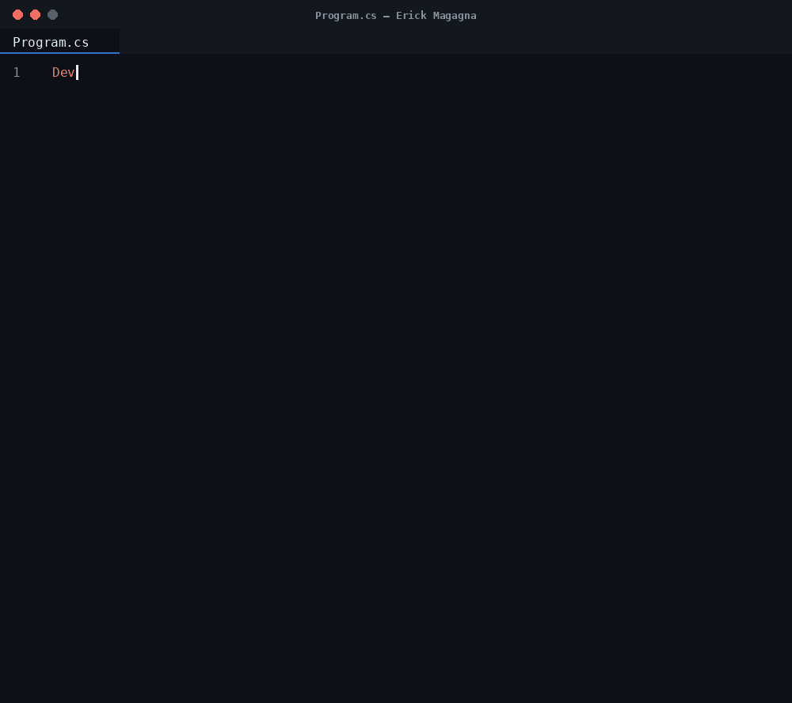

### ERICK MAGAGNA
Software Engineering student at La Salle University (Brazil), focused on backend development with C# and .NET.   When AFK, usually playing guitar 🎸.

---

---

### 🛠️ Stacks

### 🚀 Projects
<table>
  <tr>
    <td width="50%">
      <h4>💰 CDB Calculator</h4>
      
A layered console application that simulates CDB (fixed-income) investment returns.

      

        
        
      

      
<a href="https://github.com/kkcire/cdb-calculator">Repository</a>

    </td>
    <td width="50%">
      <h4>📦 Storage System</h4>
      
A console application for practicing Entity Framework Core — entities, DbContext, and full CRUD.

      

        
        
        
        
      

      
<a href="https://github.com/kkcire/storage-system">Repository</a>

    </td>
  </tr>
</table>

### 📫 Contact

